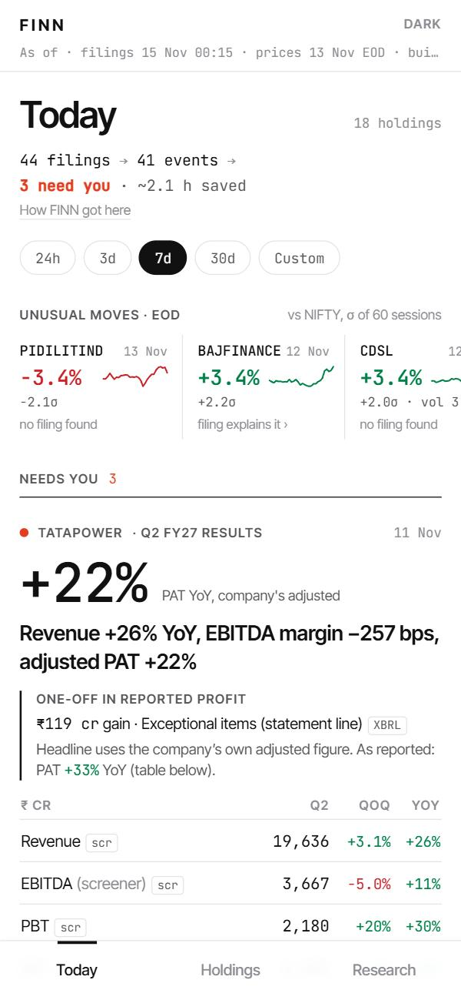
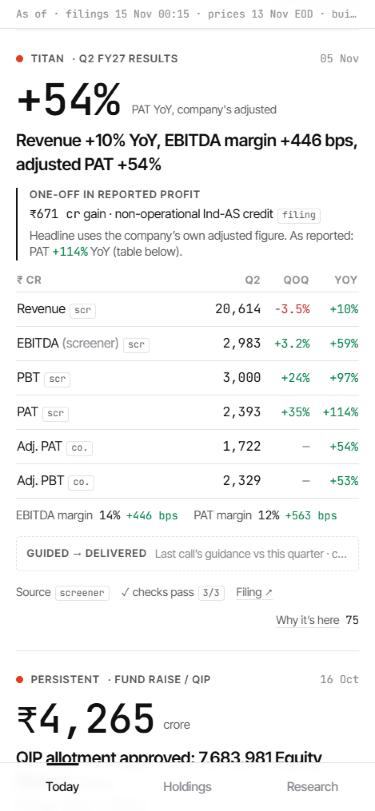
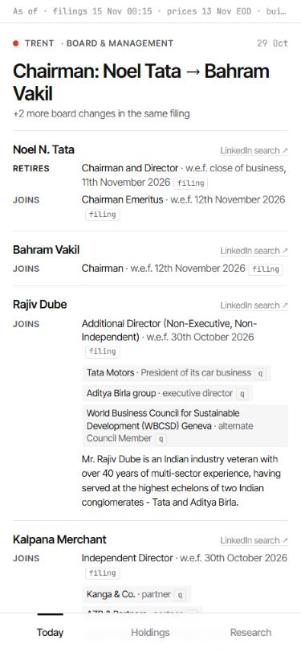
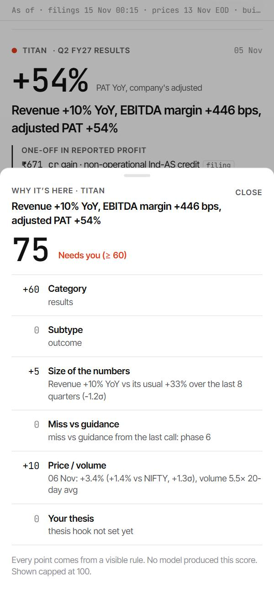

# FINN

**An investor agent that reads every filing but only interrupts when something confirms, threatens or tests why you own a stock, and holds management to what they promised.**

Investors own *theses*, not filings. FINN reads all of your holdings' NSE announcements, results, concall transcripts and annual reports. It ranks them so the few that matter rise to the top, and it grades management's guidance against what they actually delivered. Push (the Today feed) and pull (Research) share one promise store. So when results land, the card already shows *"guided X on the last call → delivered Y"*.

**Live:** https://finn-three-hazel.vercel.app (mobile-first; open it on your phone)
**Repo:** https://github.com/Yogesh-Singh-9/finn

<!-- QR code for the live link: add docs/qr.png (generate it from https://finn-three-hazel.vercel.app) -->

---

## Three tabs

| Tab | What it answers |
|---|---|
| **Today** | *What needs me?* About 230 filings over 30 days for an 18-stock portfolio become **17 "needs you" events**. Each has a score you can open to see why, a results or management card, and a "guided → delivered" row. Also: unusual moves filtered by your own alert thresholds, and a 60–90 second **Morning Call** read aloud. |
| **Holdings** | *Is my reason for owning it still true?* Dense rows (price, day move, sparkline), plus a one-line **thesis per holding**. The thesis is seeded from the latest concall and you can edit it. Every event is tagged with the thesis driver it supports or challenges, and a "watch next quarter" line comes from the latest guidance. Alert settings show how many alerts a week they'd trigger, back-tested on the last year. |
| **Research** | *Should I own it?* A dossier for any NSE ticker: business snapshot, the **Promise Ledger** (every forward-looking statement from 4 calls, graded exceeded / met / missed / revised / pending), trajectory, balance sheet, cash quality, bull vs bear and 3 questions for the next call. Five are precomputed (INFY, TITAN, POLYCAB, plus KPITTECH and ASTRAL from outside the portfolio). Any other ticker builds live on the backend. |

| Today | Results card | Management card | Why it's here |
|---|---|---|---|
|  |  |  |  |

---

## Architecture

```
SOURCES (primary only)                  PIPELINE                                OUTPUT
NSE announcements + integrated filing   classify ladder                         data/snapshots/*.json
  (XBRL results)                          1 NSE subject -> category               (static, baked into the
screener.in tables, AR + transcript       2 regex on the text                      Vercel build)
  links                                    3 PDF page 1-2 when the line is
BSE-hosted PDFs (annual reports,            useless
  concall transcripts)                     4 flash-lite for leftovers (~1%)       brief.json     -> Today
yfinance EOD prices (+ NIFTY)              5 no model -> "uncertain", +25        holdings.json  -> Holdings
                                         fold (duplicates, results day,         morning.json   -> Morning Call
                                           board changes, storylines)           research/*.json-> Research
                                         score (all Python, explainable)
                                           category + subtype + amount/TTM rev
                                           + results surprise in sigma
                                           + guidance missed/behind
                                           + abnormal return/volume
                                           + thesis supports/challenges
                                         cards: results (screener/XBRL,
                                           checks, one-offs), management
                                           (Reg 30 annexure)
                                         promise ledger <- 4 transcripts (shared store,
                                           read by both push and pull)
```

- **Frontend:** React 18 + Vite + TypeScript + Tailwind, a static PWA on Vercel. It reads precomputed snapshots first, so the demo never depends on a server.
- **Backend:** Python 3 + FastAPI (`backend/finn/`). Ingestion and build scripts run locally. The research API is on Render's free tier and only builds tickers the app has never seen, with staged progress shown in the UI.
- **Rebuild order:** `refresh.py` → `build_research.py` → `build_holdings.py` → `build_brief.py` → `build_morning.py` → `sync-data`.

## Models and cost

Rules run first. A model only gets what rules can't place, and **it never does arithmetic**: it extracts numbers as written, or writes prose from numbers Python computed. Every extracted quote is checked verbatim on its page; anything not found is dropped. Answers are cached by content hash, keyed to the model that actually answered.

| Tier | Chain (free tiers) | Used for |
|---|---|---|
| cheap | gemini-3.5-flash-lite → Groq | leftover classification, management cards, one-line summaries, guidance extraction, business snapshot, thesis seeding and tagging |
| strong | gemini-3.8 → 3.6 → 3.5-flash → Groq | qualitative promise grading, bull/bear, concall questions, Morning Call script |

| Workload | Live calls | Est. cost (list price) |
|---|---|---|
| Brief: 233 filings → 192 events (**231 never touched a model**) | 31 | ≈ $0.02 |
| One research dossier (ledger + business + bull/bear) | 5–7 | $0.004–0.009 |
| Theses for 18 holdings | 17 | $0.006 |
| Morning Call script | 1 | $0.001 |
| **Everything built so far** | **148** | **≈ $0.11** (actual spend $0, free tiers) |

## Key decisions

- **Thin but working over broad but broken.** Three screens, no tabs added, and every number has a source tag.
- **One source per number.** Screener provides quarterly actuals. NSE XBRL fills the current quarter only when screener lags, and the card says so. PBT and EBITDA definitions were checked against the filing PDFs.
- **The score is explainable, not learned.** Every event carries its breakdown. One price move has one owner (results take the reaction, and the other events note it).
- **Adjusted figures come from the company, not the model.** A one-off is used only when the company itself states the adjusted number (TITAN Q2: PAT +54% adjusted vs +114% reported).
- **Promises are graded in Python.** "Towards X" counts as met only once X is reached. Industry-relative and wrong-unit targets aren't graded. Revisions are tracked across calls.
- **Static first.** The demo can't break on a cold server, and live building is an add-on.

## Deliberately left out

Login and multiple users, intraday data, news and broker notes (primary sources only), LinkedIn scraping (bios come from the Reg 30 annexure plus a LinkedIn *search* link), a network or "who to call" view, Telegram push, and multiple themes.

## Known issues (honest)

- **On live builds, the business snapshot and bull/bear can be skipped.** In one live HAVELLS build from a phone, both were dropped with "time budget spent".
  - Diagnosed after that run, not yet deployed: the Groq fallback model (`llama-3.3-70b-versatile`) has been retired and returns `404 model_not_found`. The chain therefore had no working fallback while Gemini's strong models were timing out.
  - The "empty" Groq error in the dossier note was that message cut off at 60 characters. Errors should be logged with their type and repr.
  - The annual report is also read twice with pypdf: about 45s for 450 pages locally, and several times slower on Render's free CPU.
  - Fix ready: switch to `groq:openai/gpt-oss-120b` (tested: a 7k-token prompt answered in 1.8s), read the report once, and run the last stage's model calls in parallel.
- **A live build takes about 4 minutes including a cold start.** The free Render service sleeps after 15 minutes. The UI's "1–3 min" estimate is optimistic.
- **A few ranges get extracted as promises without a metric** (e.g. "Product ranges 5% to 20%"). These should be dropped when no metric is attached.
- **`built_at` shows UTC, not IST,** on dossiers built on Render.
- Thesis tags are made against the seeded drivers, not your edited thesis (the UI says so). Alert *categories* affect only the alerts/week estimate, not the feed.
- TRENT has no concall transcripts on screener, so it isn't in the ledger. It's the management-change demo instead. KPITTECH's business snapshot has no description, because no supporting quote could be verified.

## Next steps

1. Ship the live-build fix above, with a `/api/health` that makes a real one-token call to each provider.
2. A scheduled GitHub Actions refresh. NSE, screener and Yahoo were all verified to work from GitHub's runners.
3. Real push (web push or Telegram) for needs-you events, using the alert thresholds you already set.
4. Re-tag events against the user's edited thesis (needs a small backend write path).
5. OCR for scanned transcripts. One ASTRAL call is image-only today.

## Run it locally

```bash
cd backend && python -m venv .venv && .venv/Scripts/pip install -r requirements.txt   # keys go in backend/.env
.venv/Scripts/python scripts/refresh.py && .venv/Scripts/python scripts/build_brief.py
cd ../frontend && npm ci && npm run dev    # http://localhost:5173 (proxies /api to :8000)
```

How this was built with AI: [docs/ai-history](docs/ai-history/README.md).
